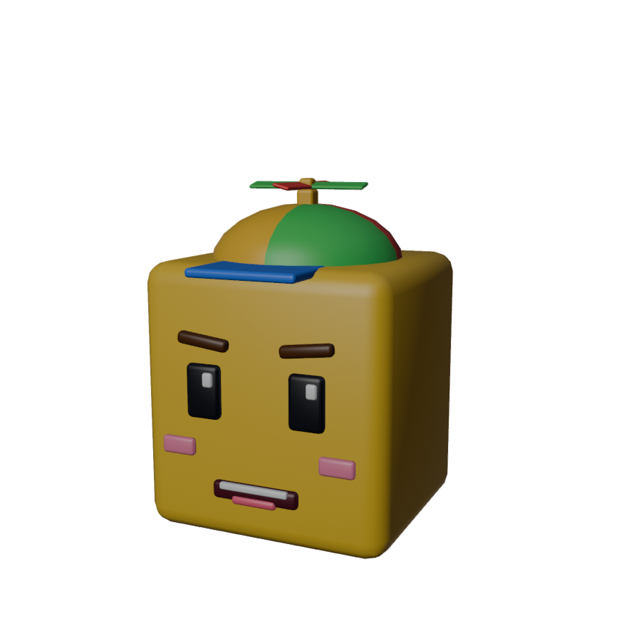
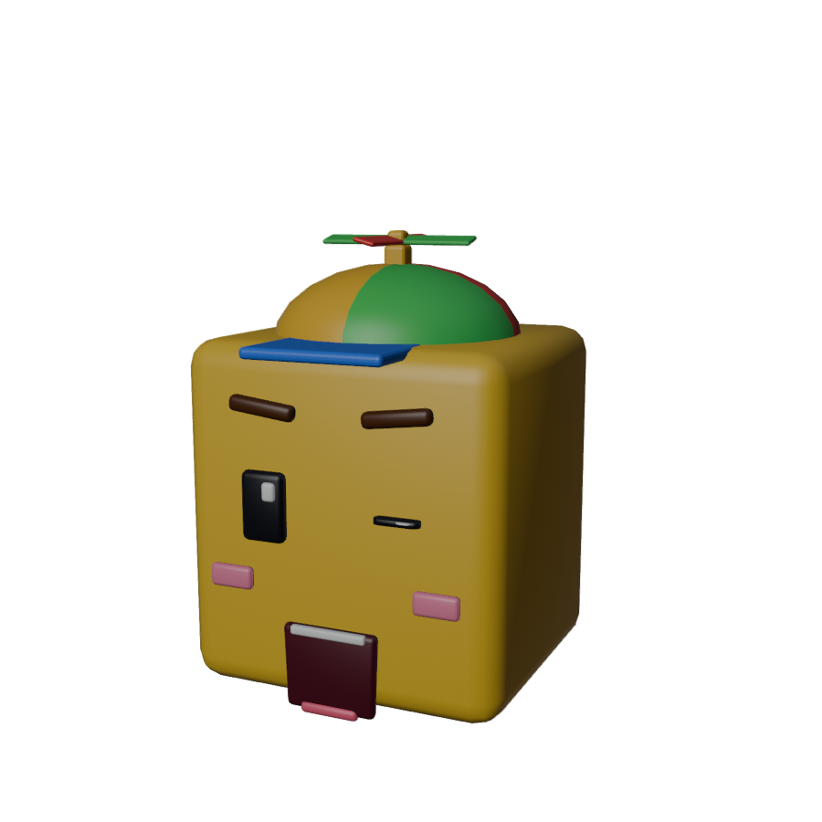

# Cabeza Cubo 🟨 · filtro facial de RA

Filtro de **Realidad Aumentada** para la cámara frontal: al abrir la página detecta tu cara y la cubre con una **cabeza de bloque** de diseño propio, con gorro de hélice. La máscara sigue los giros de tu cabeza, **imita tus gestos** (parpadeo, cejas, boca) y **reacciona** con efectos.

> Actividad 2 · Realidad Virtual y Aumentada: Filtro facial interactivo con máscara animada reactiva a gestos.

**▶ Probar:** https://rosauraaa.github.io/cabeza-cubo-filtro/
**🎥 Video demo:** _(agregar enlace al video de 30–60 s)_

| Normal | Con gestos (guiño, cejas arriba, boca abierta) |
|---|---|
|  |  |

## Gestos

| Gesto | Qué pasa |
|---|---|
| 😮 **Abrir la boca** | La boca del cubo se abre siguiendo tu mandíbula. Al pasar del **50 %** sale una **explosión de confeti de cubitos** con sonido "boing". |
| 🤨 **Subir las cejas** | Las cejas del cubo suben. Al pasar del **55 %** el **gorro sale volando** girando y la hélice acelera, con sonido. |
| 😉 **Guiñar un ojo** | El ojo del cubo se cierra. Si un ojo está cerrado y el otro abierto, salen **estrellitas** con un "ding". |
| 😑 **Parpadear** | Los ojos del cubo parpadean contigo. |

Cada disparo tiene una pausa de 0.9 s para que no se repita sin parar, y la etiqueta del gesto se ilumina en pantalla.

## Diseño y animación (Blender)

La máscara se hizo completa en **Blender** con el script [`blender/build_mask.py`](blender/build_mask.py):

- **Cabeza:** cubo biselado de 1.42 × 1.5 anchos de cara, para que **cubra todo el rostro**, con ojos, brillo, cejas, rubor, boca, dientes y lengua.
- **Shape keys** (exportados como *morph targets* en el GLB): `BlinkL`, `BlinkR`, `BrowsUp`, `MouthOpen`. Se controlan en vivo con los *blendshapes* de MediaPipe.
- **Animaciones propias** (acciones de Blender en el GLB): `PropellerSpin` (la hélice gira en loop) y `CapBob` (el gorro rebota y se balancea).
- Un solo archivo: `assets/models/mask.glb` (240 KB).

## Cómo funciona

1. `getUserMedia` abre la **cámara frontal** en cuanto carga la página: la app abre directo al filtro.
2. **MediaPipe Face Landmarker** entrega 478 landmarks, 52 blendshapes y la matriz de transformación facial de cada frame.
3. La máscara se coloca en una cámara ortográfica con las mismas medidas que el video:
   - **posición:** punto medio entre los landmarks 234 y 454 (los lados de la cara);
   - **escala:** distancia entre esos dos puntos, así que la máscara crece o se encoge con la distancia;
   - **rotación:** la matriz de transformación facial de MediaPipe (giros en los 3 ejes).
4. Suavizado ligero (`SMOOTH = 0.55`) para que no tiemble y sin desfase visible.
5. El video y el canvas se reflejan juntos con CSS (modo espejo).

Los umbrales y la escala están al inicio de [`js/main.js`](js/main.js) por si hay que calibrar en algún teléfono.

## Herramientas

- **Blender 5.2**: modelado, shape keys y animación de la máscara.
- **MediaPipe Tasks Vision 0.10.14** (Face Landmarker): detección facial y gestos.
- **three.js r160**: render 3D de la máscara (GLTFLoader + AnimationMixer + morph targets).
- **Web Audio API**: sonidos sintetizados.

## Estructura

```
index.html                 video, canvas, etiquetas de gestos
css/style.css
js/main.js                 cámara, seguimiento, gestos, partículas
js/sfx.js                  sonidos
assets/models/mask.glb     máscara (modelo propio)
blender/build_mask.py      genera mask.glb y las vistas previas
docs/                      vistas previas y artículo
```

## Instalación y ejecución

1. **En el teléfono:** abre https://rosauraaa.github.io/cabeza-cubo-filtro/ y permite la cámara. Toca la pantalla una vez para activar el sonido (los navegadores lo exigen).
2. **En la compu:**
   ```bash
   npx serve .      # o: python -m http.server 8000
   ```
   Abre `http://localhost:3000` (la cámara solo funciona en `localhost` o con HTTPS).
3. **Regenerar la máscara:** `blender -b -P blender/build_mask.py`

### Publicar en GitHub Pages
Settings → Pages → *Deploy from a branch* → `main` / `(root)`.

## Pruebas

- [ ] Teléfono 1: _(modelo / navegador)_
- [ ] Teléfono 2: _(modelo / navegador)_
- [ ] Con lentes · con poca luz · con otra persona

## Créditos y licencias

| Recurso | Autor | Licencia |
|---|---|---|
| Máscara Cabeza Cubo (`mask.glb`) | Rosaura Quintana (Blender) | CC BY 4.0 |
| Efectos de sonido | Rosaura Quintana (Web Audio) | CC BY 4.0 |
| [MediaPipe Tasks Vision](https://developers.google.com/mediapipe) + modelo Face Landmarker | Google | Apache 2.0 |
| [three.js](https://threejs.org) | three.js authors | MIT |

Código bajo licencia [MIT](LICENSE).
